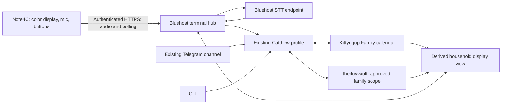

# Catthew household terminal on Zectrix Note4C

Status: APPROVED — canvas verdict fb-65 and subsequent user message "approved plan" authorize the selected design and delivery path. Implementation progress, tested slices, and deployment blockers are tracked in `docs/CATTHEW-IMPLEMENTATION-PROGRESS.md`.

## Objective and settled requirements

Modify the cloned Hearth project into a color Note4C voice/display terminal for the existing Hermes profile `catthew` on the Bluehost VPS. Preserve the existing Catthew SOUL as the identity anchor. Keep the runtime, speech endpoint, household integrations, and persistent data on the VPS. The Mac is a development, USB provisioning, and recovery workstation only. Telegram and CLI remain channels to the same profile.

The terminal has exactly two screens per the latest user direction: daily tasks and agent chat. Household events and tagged family notes remain available through Catthew rather than standalone display pages. Catthew processes English requests and returns a concise text reply plus an updated display. Calendar is **Kittyggup Family**, timezone **America/Vancouver**. Preserve existing `catthew` task selection and creation rules; make exact `kittyggup`-tagged reference notes available for family questions. Use household-scoped capabilities and a distinct persistent Note4C conversation; preserve Telegram and CLI access to the same Catthew identity and household records.

The intended model is **ChatGPT Terra6.1**, exact identifier `openai-codex` / `gpt-6.1-terra`, per the user's latest explicit selection, superseding the earlier Sol choice. Do not substitute another model or create new provider credentials. Preserve SOUL throughout.

Low-risk household task creation may proceed immediately. Changing/deleting calendar events or performing unrelated consequential actions requires explicit confirmation. Replies must be both displayed as text and spoken in English through the device speaker. Hold the front button to talk, release to send, and short press to change pages. These output and gesture choices were explicitly confirmed in chat after the canvas annotations.

## Verified evidence

- Clone: `/Users/theduy/Repo/hearth`; origin `https://github.com/shantanugoel/hearth`; inspected commit `edd75fd7ea7e9879b141a84aa39ce2c74b6c92bc`.
- Baseline: `cd /Users/theduy/Repo/hearth && python3 -m unittest discover -s tests -v`: 59 tests passed, including host C++ model and simulator checks. This is not a color hardware validation or full ESP-IDF firmware build.
- Mac exposes `/dev/cu.usbmodem101`; physical board identity and flash size still require verification before any device operation.
- SSH alias `bluehost` works in batch mode. Existing Hermes profile: host `/root/.hermes/profiles/catthew`. Vault: host `/root/theduyvault`.
- Hermes runs in Docker. Host `/usr/local/bin/hermes` is a wrapper around `docker exec` into container `hermes`; its profile paths use `/home/hermes/.hermes/profiles/catthew`, and household instructions refer to `/vault`. Service additions must respect existing mounts and runtime ownership.
- Initial inspection found `grok-4.7` / `xai-oauth`; the user first selected Sol, then explicitly selected **ChatGPT Terra6.1**. The live profile currently matches `openai-codex` / `gpt-6.1-terra`. Verify effective runtime and profile selection before any configuration change; historical observations do not override the latest user choice.
- Existing `household-task-briefings` skill names calendar **Kittyggup Family**, timezone **America/Vancouver**, and a task selection rule based on tag `catthew`. It already expects dated tasks to link to calendar events and requires confirmation before calendar edits/deletions.
- Existing Google helper supports explicit `--calendar` selection; default is `primary`, so every integration must pass the family calendar ID explicitly. Calendar OAuth files exist; live authorization, scope, calendar access, and write permission have not been tested.
- A text scan found one Markdown file mentioning `kittyggup` and none mentioning `kittygup`. This is a search result, not a verified count of correctly tagged notes. Existing tags and task schema need exact frontmatter/body-tag parsing.
- Vault `CLAUDE.md` labels Tasks read-only, while Catthew household instructions authorize writing tasks. The user selected the existing recommended household workflow, including low-risk task creation. Use that task workflow within its existing scope; document the narrow authority clearly rather than expanding write access across the vault or repeatedly asking permission for authorized household tasks.
- VPS resource sample: approximately 3.9 GiB total RAM, 557 MiB available, 5.3 GiB swap in use. There are multiple existing containers. Local STT must be measured under this load.
- `hub/server.py` exposes unauthenticated board, voice, health, and diagnostic routes; it assumes trusted deployment. Its voice queue and request dedupe are in memory.
- `hub/hermes.py` invokes a configured profile command with `--yolo --skills hearth-board -z`. In this Hermes version, one-shot help itself says approvals are auto-bypassed. Removing `--yolo` alone would not establish a safe device boundary.
- `hub/server.py::file_transcript` recognizes success through Hearth board mutation metadata. It must support ordinary answers and calendar/vault outcomes, rather than treating a successful non-board answer as “Heard, not filed.”
- `tools/install_hearth_profile.sh` overwrites SOUL, model/provider settings, and disabled skills. Replace this installation path for this project; never run it against Catthew.
- `firmware/main/hearth_net.cc` currently sets neither an authorization header nor an explicit TLS trust bundle. Add authenticated HTTPS and proper server verification for a VPS endpoint.

Additional hardware and installed Hermes ingress findings are recorded below.

## Proposed architecture

Catthew remains the agent. The hub owns device authentication, request lifecycle, speech transport, and a derived display view. Add private VPS text-to-speech synthesis of Catthew's reply and authenticated delivery of bounded audio to the device speaker. Calendar and vault own household facts. Chat history is conversational context, not the task database. A terminal session is distinct from a private Telegram transcript while sharing profile identity and approved tools.

### Integration choice

1. Recommended: extend the existing multiplexed Hermes gateway with its installed HTTP API adapter. Source verifies `POST /p/catthew/v1/chat/completions`, profile-scoped bearer authentication, `X-Hermes-Session-Id` for transcript continuity and `X-Hermes-Session-Key` for channel memory scope. Send no replacement system prompt. Use a stable dedicated Note4C session and serialize its turns in the hub.
2. Consume streaming SSE, including `approval.request` and `hermes.status`; decisions go to the profile-prefixed `/v1/runs/{run_id}/approval` endpoint using the offered choices and request ID. A complete HTTP response is not itself proof that a requested tool action succeeded. Track provider/tool outcomes and partial completion.
3. Avoid the old one-shot subprocess and a new custom platform adapter: the installed gateway already has the required contracts. `hermes serve` is a different desktop backend and is unnecessary for this integration.

The root gateway is running and reports Catthew Telegram connected. The default API listener `127.0.0.1:8642` refused a fresh connection; its stored disconnected status is old. This is an implementation prerequisite, not a currently working endpoint. Verify the API key and profile route after enabling the adapter with approved configuration. Do not read/export its key to the device.

All components will live on the same VPS. Reach the gateway through loopback when colocated or an explicitly configured private container network; no SSH or reverse tunnel is needed. Do not blindly resubmit a disconnected streaming request: the inspected streaming path lacks the nonstreaming idempotency wrapper. Persist run IDs and the request journal, reconcile whether a tool committed, and report an uncertain outcome rather than repeating a potentially completed write.

Installed evidence: container `/home/hermes/.hermes/hermes-agent/gateway/platforms/api_server.py` (profile routing, auth, startup guard), `api_server_openai_routes.py` (session headers, streaming events), `api_server_runs.py` (approvals and cancellation), and `agent/prompt_builder.py` (profile SOUL loading). These contracts were inspected in source; no live Catthew turn or approval was exercised.

### Device networking and authorization

Use `https://zectrix.theduy.cloud` with a dedicated revocable device credential. Verify existing DNS, ingress ownership, and TLS provisioning before deployment; naming the hostname does not establish DNS credentials or authorize changes to unrelated routes. Bind internal hub, STT, agent ingress, and mutation tools to loopback or a private container network. Expose only required device routes through a reverse proxy; board mutation/MCP routes and detailed health diagnostics remain private.

Verify certificates on the ESP32 using ESP-IDF trust support. Provision Wi-Fi and the device credential outside Git; do not bake account credentials into firmware. Apply request size/duration limits, bounded queues, and rate limits. Reject unauthorized requests before accepting audio or reading household data.

Tailscale is installed on the VPS, but the ESP32 is not automatically a Tailscale client. A private-only design would need a home router/gateway; it cannot depend on the Mac being awake. Choose that option only if such an always-on home gateway exists.

A device credential authorizes a household terminal, not a particular person. Ordinary voice input does not authenticate the speaker. The approved capability boundary is household scope, with immediate low-risk task creation and explicit confirmation for calendar edits/deletions or unrelated consequential actions. Do not expose Catthew's unrestricted shell or account authority through the terminal. Enforce this boundary at tools/credentials, not solely through prompt wording. Proposed confirmation delivery is private Telegram for consequential actions; the user has not yet selected the confirmation surface.

### Household sources and sync

- Calendar: target the existing family calendar by verified ID, using America/Vancouver unless corrected. Read recurring events, all-day events, cancellations, timezones, and DST correctly.
- Tasks: reuse the existing vault schema and Catthew task workflow. Use stable note/task IDs, retain calendar event IDs where present, and reconcile existing links before creating anything.
- Family notes: parse exact YAML/body tags for the agreed `kittyggup` scope. Do not project the entire vault. Tagged reference notes should be searchable by Catthew; relevant answers appear on the chat screen rather than a separate notes screen.
- Settled visibility: existing `catthew` tasks plus exact `kittyggup`-tagged reference notes, following the recommendation attached to canvas annotation fb-57. No mass retagging. Existing dated-task/calendar links remain intact. This selects the canvas recommendation; it does not silently include all tasks in the vault.
- Reuse the existing dated-task-to-calendar behavior. Do not install a second competing automatic synchronizer. Ordinary calendar events do not automatically become duplicate tasks.
- Hub display data is a rebuildable cache. Changes from Telegram/CLI and manual calendar/vault edits must appear without a voice request. Use bounded periodic source refresh plus immediate refresh after verified writes; external edits need no agent turn per poll.
- Distinguish a verified empty calendar from an API failure. Retain the last good view with a freshness marker on errors.
- Handle partial success explicitly: if a task note is saved but the event write fails, report that exact state and retry/reconcile the missing action without creating another task.

### Color display and voice experience

Use the panel's real supported palette. The first usable release must display color, including meaningful accent categories; a monochrome-only port does not satisfy this request. Official documentation confirms 400×300, SSD2683, black/white/red/yellow, and normal full-screen refreshes over 10 seconds. The official reference is `LazyYoun/youn-ink-fourcolor-firmware`, branch `2bp`, inspected commit `8907e59300fde3b77a385dba9f3070b0de17b4c8`. Its driver packs four 2-bit pixels per byte: black=00, white=01, yellow=10, red=11; a frame is 30,000 bytes. Check upstream license/attribution before vendoring. Confirm driver and waveform against the actual Note4C revision.

Hearth's current 4bpp API is grayscale, not four-color. Its default BUSY timeout is 2 seconds, whereas the reference color driver allows 120 seconds. Rework the lifecycle and watchdog behavior, and schedule display work off the UI/button-dispatch loop. Do not just change the pixel packing or timeout.

Existing physical behavior is front GPIO0, active low, 450 ms long-press threshold, recording until release, at most 12 seconds, 16 kHz mono PCM16 WAV. Codec startup adds latency; show a ready cue before speaking. Decide whether 12 seconds is sufficient for Catthew conversation. Historical `docs/VOICE.md` has stale navigation information; current source is authoritative.

User-selected display: exactly two screens, Daily tasks (`today`) and Catthew chat (`reply:0`). Show up to five overdue/due-today/undated tasks with an overflow count and a single-screen latest-reply preview; no extra pagination. Calendar and notes are available through agent questions. Both navigation directions toggle between these views. Black for main text, red for overdue/urgent content, yellow for highlights, white background. Pair color with labels/icons.

Batch changes and repaint only when visible content changes or the selected page changes. Account for the slow full-refresh panel. Use immediate LED/beep feedback during recording/processing rather than repeated screen refreshes. Never interrupt a display waveform unsafely to capture speech; confirm whether the actual driver permits recording while refresh runs.

Confirmed button behavior: hold front to speak, release to submit; short press advances a page. Keep short-press behavior consistent when an action is awaiting approval; it must not implicitly approve an action. Proposed consequential approvals go through private Telegram. If the user later selects device-side approvals, specify a separate explicit interaction rather than overloading page navigation. No wake-word listening in the initial design.

Both displayed text and English spoken replies are required. Add a VPS TTS service and device playback path. Start from the existing ES8311 speaker/audio support; verify supported sample rate, PCM format, buffering, and amplifier control before selecting the wire format. Bound reply length and audio size. Keep microphone recording and playback mutually exclusive; a new hold-to-talk interrupts playback, gives a ready cue, and begins recording without recording Catthew's own voice. Do not automatically speak proactive calendar/vault refreshes or private Telegram content.

If TTS or playback fails after a household action succeeds, keep the verified text result and show a playback error; never repeat the household action to regenerate speech. Keep the display readable while offline. A retry uses the same durable request ID; it must not create a duplicate calendar event or task after a timeout or reboot.

### Speech service

Host the STT endpoint on Bluehost as requested. Benchmark a small quantized CPU model with real English household speech. English is the selected input language; Vietnamese is outside the initial scope. Measure transcription quality, total latency, peak RAM, and effect on Catthew/Telegram. Existing ChatGPT authentication does not establish access to a separately billed transcription API.

If the current VPS cannot provide acceptable local STT, report measurements and choose between a smaller model or an explicitly approved resource upgrade. No silent paid service, provider change, or remote cloud transcription substitution.

English TTS is required on the VPS. Evaluate a maintained lightweight CPU speech engine with an English voice and compatible licensing; prefer an existing suitable dependency/service, otherwise select one during technical validation. Benchmark STT and TTS together against the existing workload. Limit speech to concise terminal replies, cache only per-request audio as needed for delivery, and provide authenticated retrieval without exposing the Hermes API credential. The device can begin audio playback independently of the slow screen refresh. TTS failures must not block displaying a completed result. Do not assume ChatGPT model access includes a speech API. New paid speech services or VPS upgrades require explicit authorization.

Default privacy proposal: raw microphone audio and synthesized reply audio kept only as needed for processing/delivery and then deleted; logs store request state and error categories rather than full family transcripts. Crash/retry retention must have a defined bound.

## Implementation stages and acceptance criteria

### 1. Resolve contracts and preserve existing behavior

Verify effective Catthew runtime and the exact ChatGPT Terra6.1 identifier, calendar ID/access, existing task schema, household tool boundary, `zectrix.theduy.cloud` DNS/ingress, and English STT/TTS service choices. Output and gesture choices are settled: spoken plus text, hold-to-talk/release-to-send, short-press page navigation. Record baseline Catthew SOUL/config hashes. Establish the supported agent ingress and session contract. Create an isolated implementation branch/worktree after final approval.

Pass: no unresolved product or authorization choices; exact paths and ingress documented; baseline tests green. No remote mutations yet.

### 2. VPS text path before hardware

Replace specialized Hearth profile installation/invocation with the approved Catthew integration. Add typed request states (accepted, processing, needs confirmation, complete, failed), reply text, result references, and durable deduplication. Prefer SQLite for hub request/cache state; keep household facts in existing sources. Build read projections from the existing calendar and vault conventions. Test using fake provider boundaries before any real writes.

Pass: text question produces a Catthew reply; one approved test task/event is created once; Telegram/CLI changes appear on the same display view; failures cannot produce false success; SOUL hash is unchanged; effective model/provider matches the verified ChatGPT Terra6.1 selection.

### 3. VPS speech and HTTPS path

Add STT and English TTS services, private routing, authenticated device ingress and reply-audio retrieval, TLS, request limits, readiness checks, and retention cleanup. Integrate with the existing Docker/runtime topology without restarting unrelated services. Verify queue recovery and confirmation handling. Benchmark speech recognition and synthesis under actual VPS load.

Pass: unauthorized clients cannot submit speech, retrieve spoken replies, or read family data; accepted audio reaches the correct session; a successful reply yields both text and playable English audio; duplicate uploads do not duplicate actions; expired credentials and speech-service outages produce clear failure states; combined STT/TTS fits an agreed measured resource/latency budget. A TTS failure leaves a successful action and its text result intact.

### 4. Note4C color port

Back up and identify the device first. Preserve the original complete flash image and checksum on the Mac before writing. Extend the existing flash tool's device identity checks rather than disabling them. Verify color test patterns, then the household UI. Port refresh scheduling, button/audio feedback, English reply playback, HTTPS trust, credentials, and request status handling.

Pass: black/white/red/yellow test pattern is correct; no continuous repaint; hold/release speech works; short press changes pages without submitting a request or approving an action; verified replies are displayed and played through the speaker; hold-to-talk safely interrupts playback; recording does not capture self-playback; errors/confirmation states are clear; device reconnects without losing or duplicating actions. Hardware test required; simulator output is insufficient.

### 5. End-to-end household acceptance

Exercise: hold the front button to ask today’s events in English, release to send, and receive both text and spoken replies; short press to change pages; interrupt a spoken reply with a new hold-to-talk; create and complete a task; create a dated task with exactly one linked event; answer a question from a scoped family note; change an item through Telegram and CLI; edit the calendar manually; lose Wi-Fi during upload/playback; reboot hub while pending; reject/cancel/expire a confirmation; test all-day/recurring events and DST; simulate TTS failure after a successful write; disconnect/sleep the Mac.

Pass: all channels use the same approved household records; device works with the Mac off; color panel remains stable; existing Catthew Telegram behavior and SOUL remain intact. Confirm real external write tests individually using clearly labeled disposable test records.

## Proposed file boundaries

- `hub/server.py`, `hub/hermes.py`: ingress/session integration, request state, user-visible reply and error handling.
- `hub/stt.py`: speech recognition adapter configuration and controlled errors; add a focused TTS adapter and authenticated reply-audio delivery. Speech-service deployment remains separate from agent/source integration.
- `hub/board.py`: replace canonical board ownership for this product with a derived household projection; remove obsolete mutable board paths once callers are switched.
- Small focused modules for calendar/vault projection and durable request state, using established libraries already present where suitable.
- `hermes-profile/hearth_mcp.py` and `tools/install_hearth_profile.sh`: replace the standalone Hearth-profile setup with an explicit existing-Catthew integration that preserves identity and current configuration. Do not keep an unsafe fallback installer path.
- `firmware/components/zectrix_epd/`: Note4C color driver integration after hardware research.
- `firmware/components/hearth_gfx/`, `firmware/main/hearth_screens.cc`: actual color rendering and household display.
- `firmware/main/hearth_net.cc`, `firmware/main/hearth_audio.cc`, `firmware/sdkconfig.defaults`, device config/provisioning and button/audio main loop: enable HTTPS (currently explicitly disabled), establish TLS trust, authenticate requests/audio retrieval, manage request lifecycle, implement bounded speaker playback and playback interruption, and keep feedback/button dispatch responsive during slow display work.
- `tools/note4_flash.py`: verified board identity and safe backup/flash/recovery.
- `tests/`, `sim/`, `docs/`: regression tests, color simulator fixtures, operations and recovery documentation.

Exact file additions and code-level tasks follow after unresolved contracts are settled; this draft is not a claim that these APIs already exist.

## Delivery and rollback boundary

Completed: clone, research, read-only VPS inspection, local baseline verification, and plan documents. Canvas annotations select a GitHub fork under **theduy3** and a PR, plus the deployment hostname **zectrix.theduy.cloud**. No fork, PR, remote edits, calendar/vault writes, profile/provider changes, installation, firmware flash, or deployment has occurred.

Proposed delivery path for final approval:

- Source: `shantanugoel/hearth`, base `main` at inspected commit `edd75fd7ea7e9879b141a84aa39ce2c74b6c92bc` (verify freshness before implementation).
- Fork: `theduy3/hearth`, subject to checking for an existing fork/name collision. Preserve an existing repository rather than overwriting it.
- Feature branch: `feat/catthew-note4c`; PR targets the fork's `main`, not upstream. Create a reviewable PR with verification evidence. Do not merge automatically; the annotation requests a fork and PR, not a merge method or upstream submission.
- Environment: existing Bluehost VPS and this user's attached Note4C; hostname `zectrix.theduy.cloud`. The final plan was approved; rollout still requires the concrete prerequisite checks below and must stop on missing credentials or external state.
- Required checks: baseline plus changed-flow tests, color simulator, ESP-IDF build, authenticated HTTPS checks, household scope/confirmation tests, live source verification, physical four-color/button/audio acceptance, restart/retry reconciliation, and existing Catthew Telegram/CLI regression checks.
- Before rollout: specify the runtime user/private network, service commands, resource limits, disposable test records, DNS management path, and recovery commands in the executable implementation plan. Never silently expand authority to unrelated VPS services.
- No new paid STT, VPS upgrade, unrelated credential changes, broad vault permission changes, force pushes, or production-service replacement is authorized by the annotations.

Audio deletion after processing and a measured STT latency review remain proposed defaults because annotation fb-64 answered GitHub delivery only.

Rollback: restore verified original firmware image; stop only new terminal/STT/TTS services and remove only their ingress route; restore only the approved Catthew integration changes from backups. Preserve valid household changes, note/event links, and request journal. Never roll back the whole vault or delete real family events to undo a software deployment. Existing Telegram and CLI should continue working while the device integration is disabled.

## Canvas decisions and remaining questions

Recorded from annotations fb-57 through fb-64:

| Topic | Decision |
| --- | --- |
| Calendar/timezone | Kittyggup Family; America/Vancouver |
| Vault scope | Existing `catthew` tasks plus `kittyggup` reference notes (the annotated recommendation) |
| Identity/model | Existing Catthew SOUL; `openai-codex` / `gpt-6.1-terra`, explicitly selected by user |
| Input language | English |
| Replies | Displayed text and English speech through the device speaker (confirmed in chat) |
| Front button | Hold to talk, release to send; short press changes pages (confirmed in chat) |
| Actions | Immediate low-risk task creation; explicit confirmation for calendar edits/deletions or unrelated consequential actions |
| Network | `zectrix.theduy.cloud` |
| Capabilities | Household scope |
| Conversation | Distinct persistent Note4C conversation, shared profile and household records |
| GitHub delivery | Fork under `theduy3`; open PR |

Output and button questions are resolved by the user's latest message. The remaining technical choices—exact model identifier, lightweight English speech engine, audio format, and measured resource limits—will be verified and filled into the executable implementation plan rather than guessed. Private Telegram remains the proposed destination for consequential action approvals; short press is reserved for page navigation.

Proposed defaults for review: delete raw microphone audio after processing and synthesized reply audio after delivery, expire unprocessed/retry audio within 24 hours, retain a minimal request/result journal without full audio, and choose speech latency targets from the VPS benchmark. These defaults were included in the approved plan. No new paid service, broad credential transfer, or unrelated infrastructure change is authorized.

## Public reference sources

- Hearth source: https://github.com/shantanugoel/hearth
- Zectrix Note4C quick start: https://wiki.zectrix.com/en/hardware/note4c/quick-start
- Zectrix community firmware catalog: https://wiki.zectrix.com/en/software/Community-OpenSource-Firmware

- Official Note4C specification: https://wiki.zectrix.com/en/hardware/note4c/spec
- Officially linked color reference: https://github.com/LazyYoun/youn-ink-fourcolor-firmware/tree/2bp
- Color reference test pattern and packing: https://github.com/LazyYoun/youn-ink-fourcolor-firmware/blob/8907e59300fde3b77a385dba9f3070b0de17b4c8/firmware/main/boards/zectrix-s3-epaper-4.2/custom_lcd_display.cc#L963

Installed Catthew configuration and skill files were inspected over SSH; no token contents were printed or copied into this plan. Hardware success, live calendar access, and gateway API/approval behavior remain unverified. No device flashing or remote configuration changes occurred.
